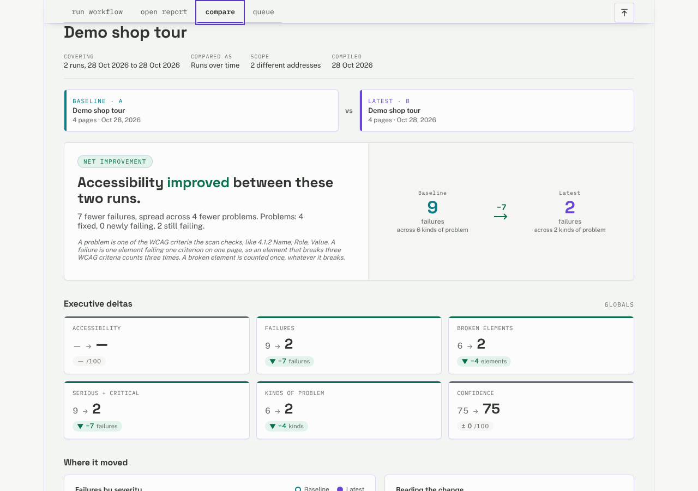

# surea11y-lab

[](https://github.com/SureA11y/lab/actions/workflows/ci.yml)
[](LICENSE)

Tools around [surea11y](https://www.npmjs.com/package/@surea11y/core) for
checking the accessibility of websites: not one page at a time, but the way
people use them, through logins, forms, menus and carts, and over time, so you
see what a release fixed and what it broke.

- **The lab app.** Build a workflow in the browser (open a page, accept the
  cookie banner, log in, add to cart, scan each state on the way), run it,
  read the report, and compare reports: two side by side, or up to 24 as a
  dashboard of what changed between them.
- **The runner.** The same workflow from the command line, with no window:
  for a nightly run that compares itself with the last one, a check on every
  pull request, or a batch over a list of pages.
- **Formats you can build on.** Workflows, reports, comparisons and diffs are
  JSON with published schemas, so other tools can write the workflows and read
  the results: an issue tracker, a dashboard, a script.
- **Ways to run it anywhere.** An HTTP API, a container image and a GitHub
  Action.



Scans check against WCAG 2.2 (A, AA, AAA) and EN 301 549 (V4.1.1 and
V3.2.1), with surea11y applying each standard in full. Other
engines (axe-core, Alfa, Pa11y, QualWeb) are an optional add-on, for comparing
engines.

## Quick start

Requires Node.js 22.13 or later, or 24 or later (the more-engines add-on
needs 22.22.2 or later, or 24.15 or later).

```bash
npm ci
npm start
```

Open http://127.0.0.1:3000, type a page's address, and press **Run**: the
default workflow scans the page. [Getting started](docs/getting-started.md)
goes from there to a workflow of your own, a run from the command line, and a
comparison.

To try everything on a site made for it, the examples come with a small demo
shop that has accessibility problems on purpose:

```bash
node examples/serve-demo-site.js &
node src/cli/run-workflow.js examples/specs/shopping-flow.spec.json
```

## Documentation

| Start here | |
| --- | --- |
| [Getting started](docs/getting-started.md) | Install, a first scan in the app, a first run from the command line |
| [Use cases](docs/use-cases/README.md) | Some of the things the lab is good for, each step by step: auditing a flow, nightly regression runs, a pull-request check, comparing releases, many pages at once, standards, issue trackers, dashboards, running it as a service |
| [Examples](examples/README.md) | Runnable workflows, a demo site, integration scripts, a CI workflow, a Compose file |
| [All the documentation](docs/README.md) | Every guide and reference, by what you want to do |

## What is in the repository

```
server.js            The lab app's server and its HTTP API
src/js/              The app: workflow builder, report view, Compare, Queue
src/workflow/        The workflow engine and the step definitions
src/server-side/     Running scans in a browser, surea11y, metrics, the queue
src/shared/          Code the app, the server, the runner and the extension share
src/cli/             The command-line runner
src/report/          The downloadable report and comparison
extension/           The browser extension
addons/              Optional add-ons: more-engines
schemas/             The published JSON Schemas
examples/            Runnable examples and the demo shop
docs/                Guides and references; docs/design/ holds the design notes
```

## Contributing and security

[CONTRIBUTING.md](CONTRIBUTING.md) covers setting up, testing and how the code
is organised. [SECURITY.md](SECURITY.md) explains what the lab trusts (its
server has no login) and how to report a vulnerability. Changes are listed in
[CHANGELOG.md](CHANGELOG.md).

## License

Copyright (C) 2026 Jorge Rumoroso. The lab is free software under the GNU
Affero General Public License, version 3 ([LICENSE](LICENSE)): use it, change
it and share it, and if you offer a changed version to others over a network,
offer them its source too. The engine it is built on, `@surea11y/core`, is
under the Mozilla Public License 2.0. The optional engines add-on installs
engines under their own licenses ([addons/more-engines](addons/more-engines/README.md)).
