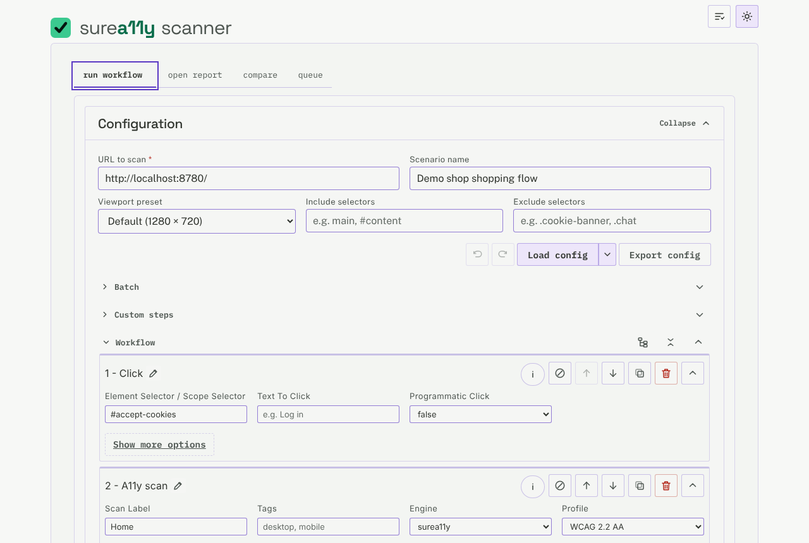
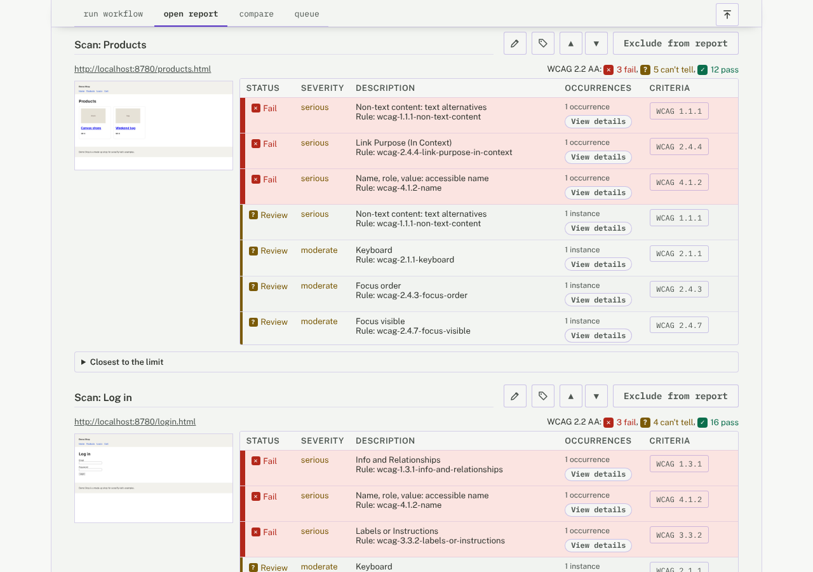
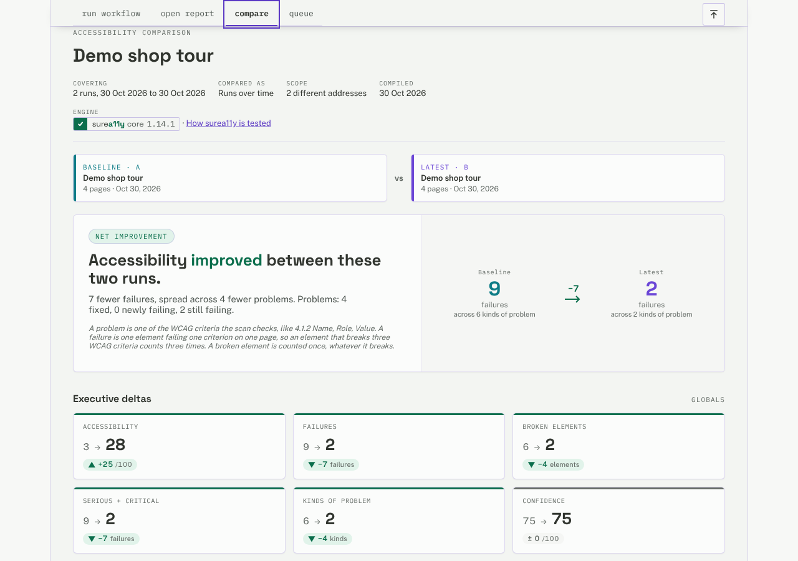

# The lab app

The app is where workflows are built and watched, and where reports are read,
downloaded and compared. Start it with `npm start` and open
http://127.0.0.1:3000 (`PORT` and `HOST` change where it listens). It has four
tabs:

| Tab | What it is for |
| --- | --- |
| **run workflow** | Build a workflow, run it, and read its report |
| **open report** | Open saved reports: one, or several merged into one |
| **compare** | Compare reports: two side by side, or up to 24 as a dashboard |
| **queue** | Batches: many runs of a workflow, a few at a time, each kept on the server |

## Building a workflow

A workflow is the page to start on and the steps to take there. The
**Configuration** section holds what applies to the whole run:

- **URL to scan**: the page the workflow starts on.
- **Scenario name**: what the run is called, in reports and file names.
- **Run settings**, the button at the end of that line, opens them in a
  dialog; under the line a chip says what each one is, so what the run will
  use is seen at a glance (the ones changed from their default stand out, and
  a chip opens the dialog at its setting):
  - **How the page is shown**, from the first page on: its **Viewport
    preset** (the window size, from a phone to a wide desktop), **Color
    scheme** (light or dark), **High contrast** (forced colors, as Windows'
    contrast themes) and **Language** (one from the list, or any tag or
    variable with Other…). Steps can change them as the workflow goes; their
    **Run default** comes back to these.
  - **Connection**: **Untrusted certificates**, Refuse unless you choose
    Accept, for a site whose certificate the browser does not trust (a
    staging server's own, or any site on a network that inspects HTTPS).
    Refused, the run fails on it, says why, and offers **Run again, accepting
    this certificate**. Accepted, the browser cannot tell the site from one
    pretending to be it, so sign in only where you trust the network; the
    chip reads as a warning, and the run's log says it accepted them.

What a scan checks, its **Include selectors** and **Exclude selectors** (limit
it to the parts of the page some CSS selectors match, `main, footer`, or leave
parts out, a third-party widget, a chat button), is each scan step's own: left
out parts are blurred in its screenshots. A configuration saved with them for
the whole run opens with them on each of its scans, as the run applied them.

What a scan checks against, its **profile**, is each scan step's choice:
WCAG 2.2 at Level A, AA or AAA, or EN 301 549 (V4.1.1 or V3.2.1), WCAG 2.2 AA
unless it says otherwise. A scan can check against several at once: one WCAG
level and any of the standards, such as WCAG 2.2 AA with WAI-ARIA 1.2
([Check against a standard](use-cases/check-against-a-standard.md#several-profiles-in-one-scan)). A scan's pictures are its screenshots; for a PNG
and an MHTML copy of the page at a point of the workflow, add a **Save
evidence** step there.



The **workflow** below is the steps, in order. There are about forty kinds:
clicking, typing, choosing from a list, waiting, scrolling, moving through
pages, changing the window size or colour scheme, and scanning; and steps
that hold others: a group, a condition, a loop over the elements a selector
finds or a list of values, a crawl that follows links, and a **Merged scan**,
whose scans are reported as one. [The step reference](step-definitions.html)
lists every step and field.

- A step can be folded, switched off without removing it, and given its own
  title. Its fields check themselves as you type, and the workflow is checked
  again before it runs, so a mistake shows at the step, not halfway through
  a run.
- **Variables** carry values between steps: read a page's text or count its
  elements into one, and use it as `{var:name}` in any field.
- **Custom steps** are workflows of your own, with inputs, used as one step:
  "log in", "accept the cookie banner", "open the product called {var:name}".
- A password goes in **Set password value**: it is hidden on screen and never
  saved. For runs nobody watches, the step can read it from an environment
  variable instead ([the runner's guide](scheduled-scans-guide.md#passwords)).

**Run** runs the workflow and shows its progress, step by step, with a log.
**Dry run** takes every step but the scans, screenshots and evidence, and
says which steps would fail, and where: the quick way to see whether a
workflow still fits a site that has changed.

**Export config**, in the Configuration header beside **Load config**,
downloads the workflow, with the form as you left it, as a `*.a11y-config.json`
file. **Load config** opens one, or a run spec written by
hand or by a tool; **Append config** adds one's steps to the workflow you
have. A link with the workflow in it (`?state=`) opens it in someone else's
app.

## Reading a report



A report has one section per scan: what failed, what passed, and what a
person still has to check, by WCAG criterion (or by the standard's own
requirements, for EN 301 549), with the elements each finding is
about, their HTML, a screenshot of each, and how to check by hand where a
person has to look. Above them, the summary: scores, what the scans covered,
and how much of the profile automated checks can reach at all.
[Reading the report](a11y-summary-ui-guide.html) goes through it part by part,
and [the metrics reference](a11y-metrics-reference.html) explains each score.

Scans can be reordered, renamed, left out of the download, and filtered by
tag and by the profile they were checked against (offered when the scans'
profiles differ); a download of the report holds the scans the filters show,
so one report can give one download per profile. A scan with some of its
profiles turned off is scored again on the ones still on, from the page
measurements the report kept, and the score says so (a report too old to keep
them shows none). Each finding lists its
criteria under their standard's name. Their findings can be grouped by WCAG principle, by WCAG level, by the
Accessibility Product Standard's KPIs, or by a grouping of your own, loaded
as a JSON file: a list of groups, each naming its requirements in WCAG or
EN 301 549 terms, or those of another installed standard, by its name as its
findings give it.

```json
[
  { "group": "Images", "WCAG": ["1.1.1"] },
  { "group": "Forms", "WCAG": ["1.3.1", "3.3.2"], "EN 301 549": ["9.3.3.2"] }
]
```

A WCAG criterion is matched exactly; an EN 301 549 clause, or another
standard's requirement, also by its number's start (`"9.3"` is every clause
under 9.3). A requirement of another
standard also counts as the WCAG criteria it corresponds to, so the WCAG
groupings group EN 301 549 scans too. An issue no group takes
goes to "Not in WCAG" when it corresponds to no WCAG criterion, and to
"Others" otherwise.

## Downloading and sharing

**Download report** gives a package: the report as a page to read, its JSON to
open again in the app, its pictures, and the configuration it ran. Its menu
also downloads the report as a single HTML file, or with the scans the tag
and profile filters hide. [Reports and their format](report-package.md) describes the
package. A link can open a report in the app directly:
`http://127.0.0.1:3000/?report=<url of its JSON or zip>`
([how](http-api.md#opening-reports-in-the-app-by-address)).

## A conformance report

**Conformance report**, in the Download menu, gives an Accessibility
Conformance Report in the layout of the VPAT 2.5 (WCAG and EU edition), as
one HTML file: a table per WCAG level and the EN 301 549 chapters.
**Conformance report (Word)** gives the same as a `.docx`, to edit and sign
in Word. It starts
as a draft from the report's scans, which never says "Supports": a failure is
"Does Not Support", nothing to apply to is "Not Applicable", and the rest is
"Not Evaluated", with what the scans asked a person to check.

**Review conformance**, beside the Download menu, is where a person decides:
the product's details, and each criterion's conformance level and remarks,
over the draft. Under each criterion, **How to check it by hand** gives what a
person checks that automated checks don't decide: the steps, what passing and
failing look like, and what it takes (a keyboard, a screen reader, zoom), from
surea11y core's test procedures, where the installed core has them. EN 301
549's own requirements (chapter 4, chapter 9's 9.6 and, in V4.1.1, 9.7,
chapter 12 and the other chapters, as the report's version numbers them) have
theirs too, from the EN 301 549 pack; chapter 9's clauses are the WCAG
criteria, reviewed once. A report scanned against another installed
standard's profile has that standard's requirements of its own too, in
sections by its groups ([Standards](configuration.md#standards)). Each
check takes a result (Passes, Fails, Doesn't apply), kept in the report with
the review; once every check of a criterion has one, the dialog suggests its
level, and **Use it** sets that level, with remarks written from the answers
where you have written none. The conformance report, in HTML and in Word,
lists each criterion's answered checks under its remarks, and its evaluation
methods say how many were answered.

**Manual review checklist**, in the Download menu where the core has the
procedures, is the same for every criterion of the report's target, and EN
301 549's own requirements, as a page
to print or share: what the scans found, what has been recorded so far, and
each check a person makes, with its steps. What you record is saved in the report as you go, so its
downloads carry it, and opening the report again brings it back. **Copy the
review of another report** fills in what this report has not decided yet from
an earlier one, so a new run keeps the verdicts of the last review.

## The testing guide

**Testing guide**, the book icon in the app's header, opens in a tab of its
own: how a person checks each requirement of a standard by hand, from
surea11y core's test procedures, where the installed core has them. Choose
WCAG (2.2, 2.1 or 2.0, and its levels), EN 301 549 or another installed
standard, or the best practices, and search it. Each requirement is a card in
the standard's own groups, with a link to it to copy; each of its checks says
whether automated checks decide it, decide part of it, or leave it to a
person, what it needs (a keyboard, a screen reader, zoom…), the steps, and
what passing and failing look like. A check folds to its title, or all of
them do (**Collapse all**), to see a requirement at a glance. **Filters**
narrow the guide to the checks that need a screen reader, say, or to what
only a person can judge, and add the technical details: the rules behind a
check, and the questions scans ask about single elements. The contents beside
it follow where you are. The address keeps what is chosen, so a link opens
the guide at one requirement (`/guide?standard=wcag&id=1.4.3`). **Save as a
page** downloads the same, as one page to keep or print; the colour theme is
the app's. It records nothing: results go in a report's Review conformance.

**The procedures are in English, for now.** The lab's own procedures, for
what no surea11y rule evaluates (`src/procedures/`), are in English, so no
standard is complete in another language: the guide reads every standard in
English and offers no other. A link that asks for one (`&locale=fr`) opens
the guide in English, and a note under the filters says so. A report's "How
to check it by hand" is in English too, whatever language its scans ran in.

A finding's **View details** links to the guide too, above its own steps,
which stay as they are: "The full method, in the testing guide", for each
criterion or requirement it names that the guide has, in the latest version
that has it. A downloaded report leaves these links out, since the guide is
the lab's.

## Opening saved reports

The **open report** tab opens reports saved before: their JSON, or a
package's zip. What you add opens at once; several are merged into one
report with all their scans, and stay listed, to choose which scans and
screenshots of each to keep and **Load selected** again. Reports saved by
older versions of the lab open as they always did.

## Comparing reports



The **compare** tab takes two reports or more, from files, zips, the run
workflow tab or the queue.

- **Two reports** are compared side by side: what was fixed, what is new, what
  still fails, rule by rule and element by element, with the scores beside
  each other.
- **Three to 24** make a dashboard: what each report cleared and introduced,
  how long each problem has been open, which criteria moved, what is still
  waiting on a person, and whether each run covered enough to be compared.

Say what the reports are, **runs over time**, **versions** or **variants**,
and the comparison reads accordingly. A comparison can be named and
annotated, and downloaded as a page, or with its reports as a zip that opens
in the tab again.

When the reports were checked against more than one profile (WCAG 2.2 AA +
WAI-ARIA 1.2, say), **Profiles compared** has a switch for each profile every
report checked. Turn one off and the comparison is read on the others: a
rule's finding is what the profiles still on make of it, a requirement of a
profile turned off goes, and each report's score is counted again on what is
left, from the page measurements the report kept (a report too old to keep
them shows no score). The choice is saved in the zip.

With two profiles or more compared, the **By profile** section says how much
of the comparison each one accounts for: every broken element is put down to
the one profile that flags it, or to *More than one profile* when several do
(WCAG 2.5.8 and EN 301 549's 9.2.5.8 flag the same small targets), so the
rows add up to the comparison's broken elements (with two reports, to those
fixed, newly broken and still broken too). Beside them, under **On its own**,
is each profile read alone: its problems, failures and score, which overlap
and don't add up.

Pages are matched across reports by their path and query. When no page is in
every report (a site under `/v1/` beside the same one under `/v2/`), the
comparison says so, since every failure then reads as fixed or new, and reads
each report on the profiles every report checked on some page.

## Batches and the queue

The **Batch** section runs the workflow once per row of a JSON list: each row
its own name, starting page and variables.

```json
[
  { "name": "Shoes", "url": "https://shop.example/shoes", "vars": { "product": "Shoes" } },
  { "name": "Bags",  "url": "https://shop.example/bags",  "vars": { "product": "Bags" } }
]
```

With the batch on, **Run** sends it to the **queue**, which runs as many at a
time as the batch has, up to eight (or the number set in **Runs at the same
time**), and keeps every result on the server as it finishes
(`reports/batches/<start time>/`). A run can be watched live; the whole batch
downloads as one zip and goes to the compare tab in one go. A batch whose
workflow types a password asks for it once, before it starts.

A finished batch can still change, while no other batch runs:

- **Run again**, on a row, runs it again from the workflow it saved, with its
  row's values. The new result replaces the old one; if the re-run ends with
  no result (the site was down, it was cancelled), the old one stays and the
  row says so. A workflow saved without its passwords asks for them first.
- **Add the open workflow** runs the workflow in the editor into the batch, as
  a row after the others.
- **Add a report…** adds a report saved before as a row of its own, without
  running anything: its `.json`, or the package **Download report** writes
  (`.zip`), whose pictures come with it.

Whatever is added is part of the batch from then on: its folder, its zip and
Send to Compare.

The same batches run from the command line ([the runner's guide](scheduled-scans-guide.md)).
